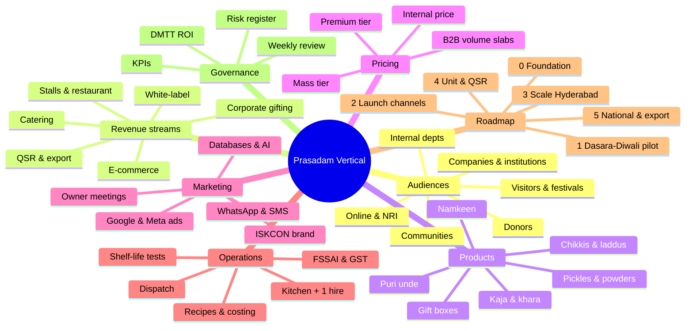
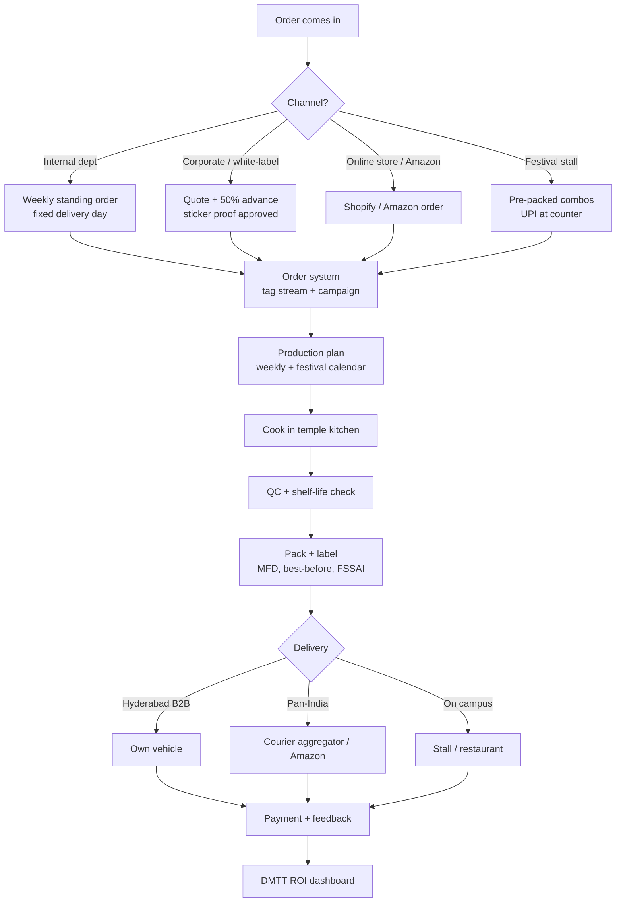
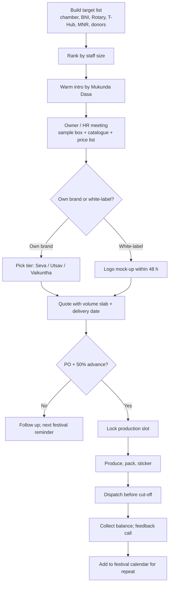
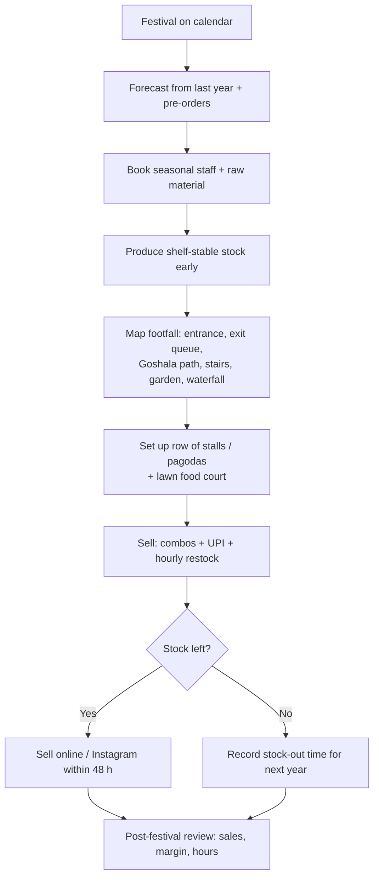
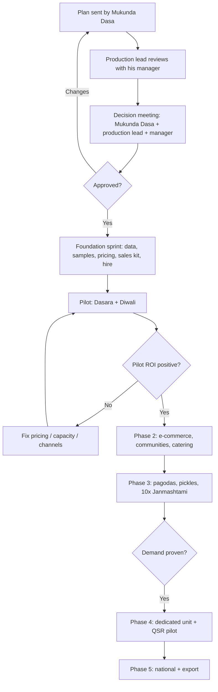
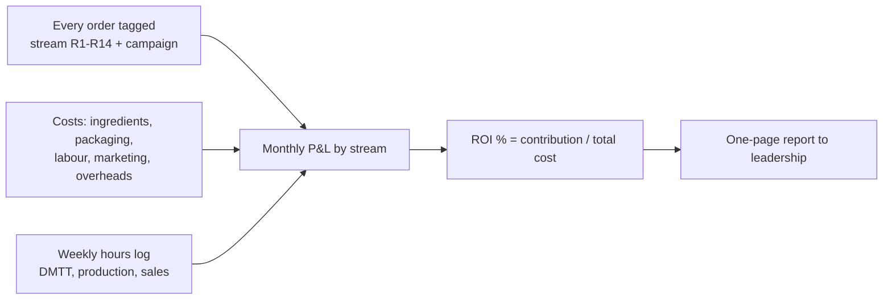
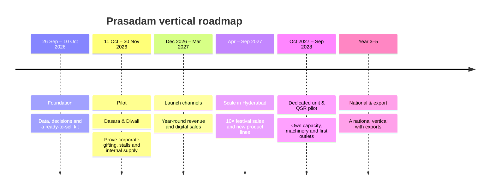

# Prasadam, Sweets & Savories Vertical: Mind Map & Flowcharts

Hare Krishna Golden Temple (ISKCON), Banjara Hills, Hyderabad · v1.2, 21 October 2026

GitHub renders these Mermaid diagrams. The fully detailed, clickable mind map is `03_Mind_Map.html` (open it in any browser).

## Mind map (overview)

## Order-to-delivery flow (all channels)

## Corporate gifting sales flow

## Festival stall operations

## Decision and phase-gate flow

## DMTT ROI tracking flow

## Roadmap timeline

